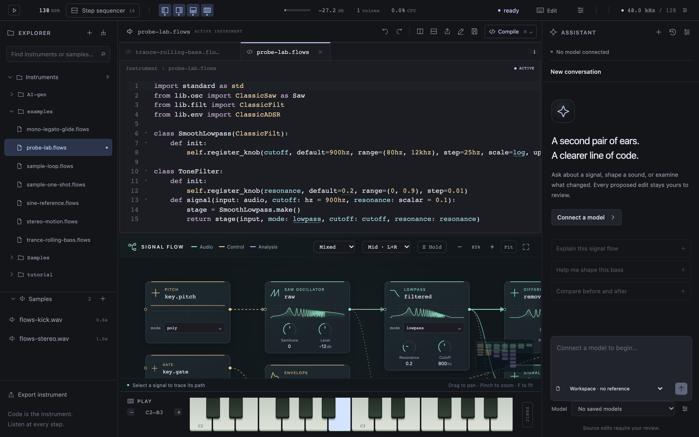
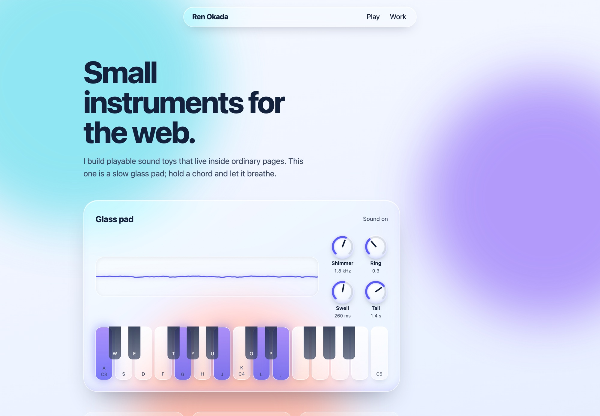
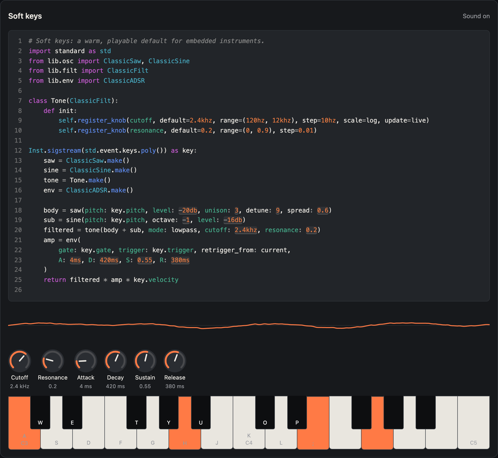

<div align="center">


# Flows

### Code you can play.

An open-source synthesizer where the source code **is** the instrument.<br>
Write a sound, hear every stage of it, and play it on your Mac, in a browser tab,<br>
or inside any web page.

[](https://github.com/flows-audio/flows/actions/workflows/ci.yml)
[](https://flows-audio.github.io/flows/)
[](https://github.com/flows-audio/flows/releases/latest)
[](#license)

**[Download for macOS](https://github.com/flows-audio/flows/releases/latest)**
&nbsp;·&nbsp; **[Open in your browser](https://flows-audio.github.io/flows/)**
&nbsp;·&nbsp; **[Put one on your page](embed/README.md)**

<br>


</div>

<br>

Most synthesizers hide the instrument behind knobs. In Flows the instrument is a
few lines of code, and everything else — the knobs, the signal flow, the scopes,
the assistant — is a view of that code. Name an intermediate signal, attach a
`probe`, and you can hear and see exactly what a filter, an envelope or a
formula changed. Drag a number in the code while a note sounds and the sound
follows.

## One engine, three places to play

The same C++ compiler and DSP engine run in all three, so an instrument sounds
the same wherever it plays.

<table>
<tr>
<td width="33%" valign="top">

### Flows for macOS


The full workspace: tabs and split editors, the Signal Flow, probes, the step
sequencer, MIDI keyboards, AU/VST3 builds and an optional assistant.

**[Download the preview](https://github.com/flows-audio/flows/releases/latest)**

</td>
<td width="33%" valign="top">

### Flows in the browser



The same editor in a tab, nothing to install. The C++ core runs as
WebAssembly in an audio worklet; your workspace stays in the browser.

**[Open it now](https://flows-audio.github.io/flows/)**

</td>
<td width="33%" valign="top">

### Flows Embed



A playable instrument, and the code that makes it, on any web page from one
script tag. Readers play it, turn its knobs and edit its code. It takes the
page's own look.

**[Embed one](embed/README.md)**

</td>
</tr>
</table>

## Put an instrument on your page

```html
<script type="module" src="https://flows-audio.github.io/flows/embed/flows-embed.js"></script>
<flows-instrument preset="soft-keys" code></flows-instrument>
```

<p align="center">

</p>

The code above the keys is live. Typing recompiles when you pause, numbers can
be dragged while a note sounds, knobs write their values back into the code,
and Reset brings back the original. Click a key and the computer keyboard plays
along while the mouse shapes the sound. Flows Embed needs no special server
headers or service worker, and every part can be restyled with `--flows-*`
properties and `::part()`. See the [live examples](https://flows-audio.github.io/flows/embed/)
and the [integration guide](embed/skill/SKILL.md), which also works as a skill
for coding agents.

## Why Flows

- **The code is the instrument.** Oscillators, filters, envelopes and your own
  formulas, in a small language made for sound. Every number that sets a
  parameter is also a control.
- **Hear and see every step.** `probe` any signal to look at its waveform,
  spectrum or power, compare `before - after`, or listen to that point alone.
- **Edits that keep playing.** Changing a value updates the running engine in
  place; held notes keep sounding.
- **One engine everywhere.** The macOS app, the browser app and Flows Embed run
  the same C++ compiler and engine; Flows Embed is tested against the native
  engine sample by sample.
- **AI that proposes, never overwrites.** The assistant can explain, compile,
  render and compare, and every source change waits for your Apply. It is
  optional and uses your own endpoint.
- **Open source.** The compiler, the DSP engine and Flows Embed are Apache-2.0;
  the complete app is AGPL-3.0.

<p align="center">
<a href="docs/LANGUAGE.md">Language and instruments</a>
&nbsp;·&nbsp; <a href="docs/ARCHITECTURE.md">Architecture</a>
&nbsp;·&nbsp; <a href="docs/learn/README.md">Source-guided learning</a>
&nbsp;·&nbsp; <a href="docs/WEB.md">Flows in the browser</a>
&nbsp;·&nbsp; <a href="ROADMAP.md">Roadmap</a>
</p>

## Try it on macOS

The downloadable preview runs on **Apple Silicon Macs**. Unzip `Flows.app`,
move it to Applications and open it. The build targets macOS 11 or later;
runtime compatibility on older macOS releases is not yet verified. The preview
is locally signed and not notarized, so macOS may ask you to allow it in
Privacy & Security.

1. Open `examples/sine-reference.flows` from Explorer.
2. Press **Cmd+K** to enter Perform mode. Play the piano, a MIDI keyboard,
   or the computer keys **A W S E D F T G Y H U J K**. **Z/X** changes octave.
3. Drag a code number or a Signal Flow knob. Hold **Shift** for fine adjustment.
4. Click a signal capsule to inspect its waveform/spectrum or listen to that
   point in the flow. Use the step sequencer for repeating patterns.

Cmd+K returns to Edit mode. `key.` opens completion; Ctrl+Space requests it,
Tab/Enter accepts, and Escape closes. Valid unsaved source drives the sound.
Save writes the source to disk. Compile or missing-sample errors mute the
affected instrument until repaired.

**MIDI keyboards:** connect a keyboard before or after opening the app. New
inputs are enabled automatically, and a port that fails to open is tried again
on the next device change. Use the sample-rate button in the top bar to open
**Audio & MIDI** and enable or disable inputs. A disabled input stays off
until you enable it again, including after it is unplugged and replugged.
Note-on, note-off and velocity work on all MIDI channels, in both Edit and
Perform modes; use `key.velocity` in the instrument to make touch affect its
sound. Unplugging or disabling any input note-offs every MIDI-held note, so
other connected keyboards are released too. On-screen keys and the step
sequencer keep playing. The release is a normal note-off, so the tail follows
the instrument's response to `key.gate`. Pitch/modulation wheels, aftertouch
and sustain pedals are not mapped yet. For AU/VST3, route MIDI to Flows
through your DAW instead.

**AI is optional.** Synthesis, editing and probes work without an account or
API key. To use the assistant, configure your own OpenAI-compatible endpoint
and model in its global settings. Keys use macOS Keychain (in the browser they
stay in the current tab only). Source proposals require Apply; the assistant
does not silently replace your instrument.

### Interface text size

**Cmd/Ctrl +**, **Cmd/Ctrl −** and **Cmd/Ctrl 0** resize or reset text throughout
the interface: editor, Explorer, assistant, Signal Flow, sequencer and menus.
Appearance → **Interface text size** controls the same saved preference.
The default is 100% (14px in the editor); other text keeps its relative size.
**Editor font** still selects the code typeface independently.

## In a browser

Open <https://flows-audio.github.io/flows/>. The same instrument runs in
current Chrome, Edge, Firefox and Safari: the C++ core is compiled to WebAssembly and plays through an audio worklet, with the
same editor. The workspace is saved in the browser; export instrument packages
to keep copies. Sound starts with your first key press or click. Web MIDI
keyboards work where the browser supports them (not in Safari). See
[Flows in the browser](docs/WEB.md) for hosting, shortcuts and limits.

To put an instrument on your own page, see [Flows Embed](embed/README.md).

## A small instrument

```flows
import standard as std
from lib.osc import ClassicSine
from lib.env import ClassicADSR

Inst.sigstream(std.event.keys.poly()) as key:
    osc = ClassicSine.make()
    env = ClassicADSR.make()
    raw = osc(pitch: key.pitch, level: -12db)
    amp = env(gate: key.gate, trigger: key.trigger,
              A: 5ms, D: 120ms, S: 0.65, R: 180ms)
    observed = probe(raw)
    return raw * amp * key.velocity
```

`raw` names the oscillator output. `probe(raw)` observes the samples already
computed by the DSP engine. More precise questions can be written as
`before - after`, `spec(before) - spec(after)`, or
`power(before) - power(after)`. Observation does not create a second sound
engine. See the [example catalogue](examples/ADCxGather/README.md) for complete
instruments and comparisons.

## What is included

- Poly/mono key policies, retrigger, glide, ADSR, sine/saw, stereo unison,
  lowpass/highpass, LFOs, distortion and pitched sample playback.
- Formula-authored oscillators using Phasor, arithmetic and sin/cos.
- Waveform, spectrum, mel and power probes, arithmetic comparisons and
  intermediate stereo audition.
- Multiple instrument tabs, split editors, completion, draggable parameters,
  enum choices, resizable panels and themes.
- A 16/32-step sequencer with per-lane instrument/sample selection, volume,
  mute, swing, scales and a metronome.
- Portable `.flowsinst` instruments, source undo, workspace recovery and
  an optional assistant with compile/render/compare tools.
- A local Live bridge for reading unsaved instrument source, previewing a
  proposal, and applying or restoring it with revision checks. The bridge is a
  private directory of JSON files. It does not talk to Ableton Live's API.

## Built with

| Technology | Role in Flows |
| --- | --- |
| C++20 | Flows' own language compiler, DSP engine and signal analysis |
| [JUCE 8](https://github.com/juce-framework/JUCE/tree/8.0.7) | Native app, audio/MIDI devices, AU/VST3 wrappers and embedded WebView |
| [React](https://react.dev/) + [TypeScript](https://www.typescriptlang.org/) | Workspace, sequencer, Signal Flow and assistant interface |
| [CodeMirror 6](https://codemirror.net/) + [Lezer](https://lezer.codemirror.net/) | Code editing and syntax highlighting, with Flows-specific completion and controls |
| Canvas 2D + SVG | Signal plots and the flow diagram |
| [Emscripten](https://emscripten.org/) / WebAssembly | The browser build: the same core, threads and an audio worklet |
| Web Components + AudioWorklet | Flows Embed: the compiler and engine as one single-threaded module, restylable elements |

CMake/Ninja build the C++ targets; Vite bundles the frontend. Dependency
versions, notices and licenses are documented in [THIRD_PARTY.md](THIRD_PARTY.md).

## Platform status and limits

| Target | Status |
| --- | --- |
| macOS Apple Silicon standalone | Preview build available |
| macOS AU / VST3 | Build targets and automated wrapper tests; host compatibility remains limited |
| Windows / Linux compiler and DSP | Linux CI build/tests passed; Windows builds are not yet verified |
| Windows / Linux desktop app | Planned; the portable app core is ready, native window/WebView/credential adapters need work |
| Browser | Static site built from each release; tested in Chromium, Firefox and WebKit |
| Web pages (Flows Embed) | One script tag, no isolation headers; tested cross-origin in Chromium, Firefox and WebKit |

The language and file formats may change. Effects run per voice; there is no
global post-mix FX chain, wavetable editor or independent sample time-stretch.
Arbitrary oscillator formulas are not automatically anti-aliased. This is not
complete Serum feature coverage. Performance depends on instrument complexity,
voice count, sample rate, observations, host and device; a full device/host
acceptance matrix has not been completed.

## Build from source

The compiler/DSP build needs **CMake 3.25+, Ninja, Python 3.9+ and a C++20
compiler**:

```sh
cmake --preset dev
cmake --build --preset dev --parallel 2
ctest --preset dev
```

For the macOS app/plugins, also install the **Xcode 26+ command-line tools** and
**Node.js 22+**, then obtain the pinned JUCE source:

```sh
git clone --branch 8.0.7 --depth 1 https://github.com/juce-framework/JUCE.git ../JUCE
npm ci --prefix ui
cmake --preset app -DJUCE_DIR="$PWD/../JUCE"
cmake --build --preset app --parallel 2
ctest --preset app
open build-app/FlowsStandalone_artefacts/Release/Flows.app
```

JUCE wrapper adapters validate the expected upstream source and generate
modified copies in the build directory. Your JUCE checkout is not edited.
Building does not install AU/VST3 plugins. Bundle paths and packaging are in
[BUILDING.md](BUILDING.md); tests are explained in [test/README.md](test/README.md).

For the browser build, install Emscripten 6.0.13 and run:

```sh
emcmake cmake --preset web
cmake --build --preset web --parallel 2
npm ci --prefix embed && npm run build --prefix embed
npm ci --prefix ui && npm run build:web --prefix ui
npm run preview:web --prefix ui
```

## Contribute

Bug reports, musical examples, clearer explanations and platform fixes are
welcome. Include a small `.flows` instrument and steps to reproduce when
reporting a problem. See [CONTRIBUTING.md](CONTRIBUTING.md) for building,
testing and proposing changes. See [ROADMAP.md](ROADMAP.md) for current priorities
and [THIRD_PARTY.md](THIRD_PARTY.md) for dependencies and attribution.

## License

The complete application is licensed under **AGPL-3.0-only**. The independent
compiler (`src/compiler/`), DSP engine (`src/engine/`) and the embeddable
instrument (`embed/`, built only from those two) are **Apache-2.0** under their
directory licenses. Linked JUCE modules and other dependencies
retain their own licenses. The browser build includes the license, third-party
notices and a link to its matching source. See [LICENSE](LICENSE), [NOTICE](NOTICE) and
[THIRD_PARTY.md](THIRD_PARTY.md). Source for each binary release is available at
its matching public tag and in the release package.
